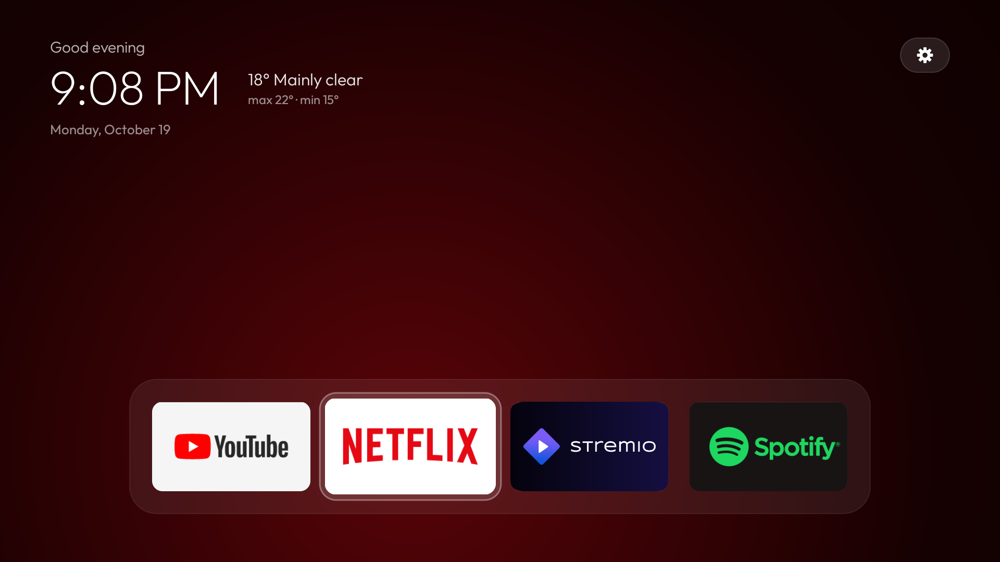
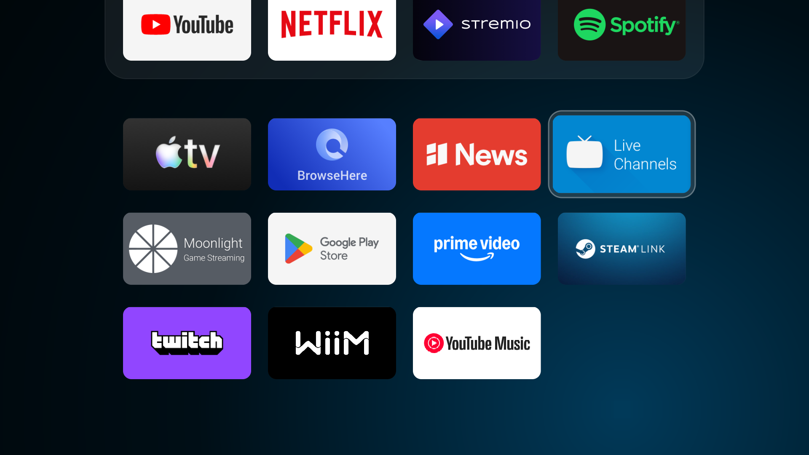
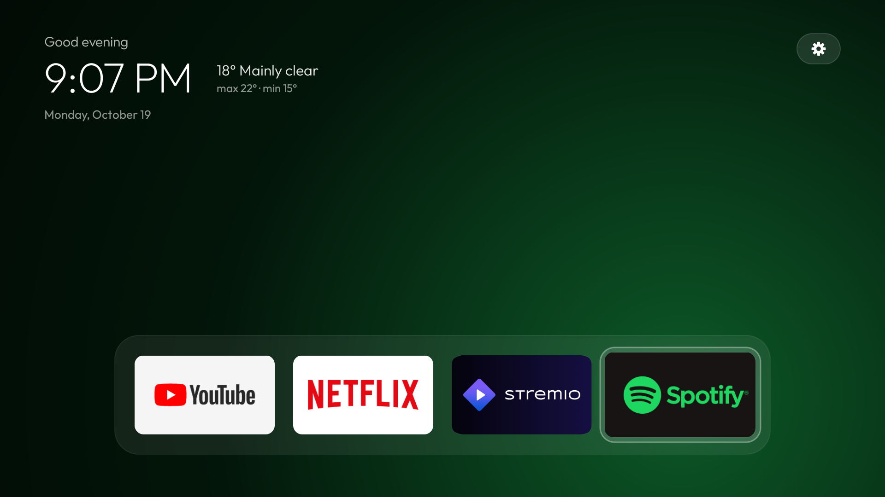
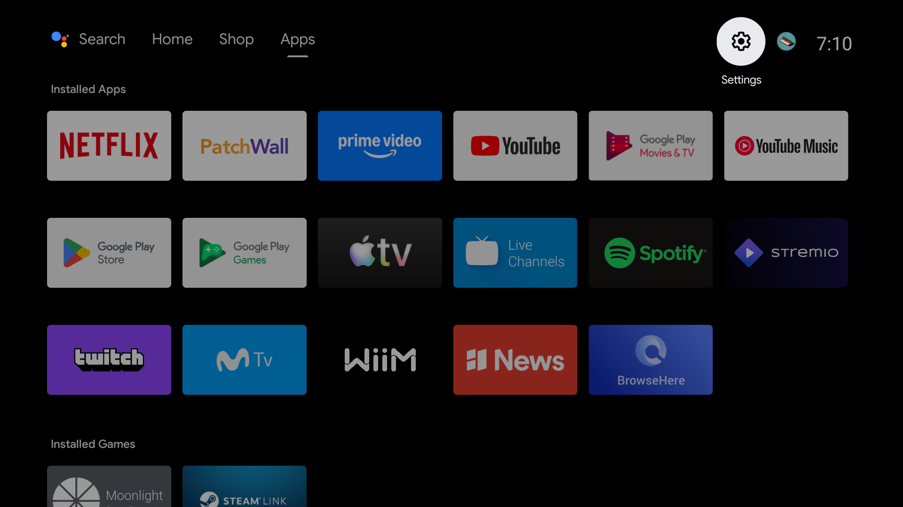

<div align="center">

# tvhome

**A 95 KB Apple TV–style launcher for Android TV, and a reversible debloat kit for the box it runs on.**

No Gradle. No AndroidX. No third-party code at all. Three permissions.
Nothing is ever uninstalled — every change is one command away from undone.

[-3DDC84?logo=android&logoColor=white)](#requirements)
[](#why-its-small)
[](#why-its-small)
[](docs/BUILD.md)
[](LICENSE)



[Español](README.es.md)

</div>

---

## What this is

Two things that happen to go together.

**A launcher.** Pitch black. A dock of four apps you actually use, everything
else in a grid below it. One translucent glass highlight that springs from tile
to tile — no per-tile borders, no labels, no rows of "recommended for you". The
only thing that reacts to focus is the background: it washes the whole screen
with a colour sampled from the app's own banner.

**A debloat kit.** PowerShell scripts that snapshot the box, disable the
telemetry/ACR/adware packages in small verified batches, and generate a restore
script from what was *actually* disabled — so rollback can only ever touch
packages this tool touched.

Built and verified on a **Xiaomi Mi Box S** (Android 9, API 28, 1920×1080 @
320 dpi, ~1 GB free RAM). It should work on any Android TV box of that vintage
or newer; the only device-specific thing in the repo is the list of packages to
disable, which lives in one script.

---

## Screenshots

| Dock | Grid |
|---|---|
|  |  |
| The backdrop is Netflix red because Netflix is focused. | Down from the dock scrolls the grid up in one move. |

| Another app, another colour | The glass highlight on the cog |
|---|---|
|  |  |
| `ColorSampler` renders the banner at 32×18 and picks the most saturated pixel. | The same highlight that moves between tiles also lands on the top bar. |

### Before

<table>
<tr>
<td width="50%"></td>
<td width="50%"></td>
</tr>
<tr>
<td align="center"><b>Stock</b> — sponsored rows, Shop tab, PatchWall, ACR.</td>
<td align="center"><b>tvhome</b> — a clock, the weather, your apps.</td>
</tr>
</table>

---

## Why it's small

95 KB, and the biggest single thing in it is the font.

| Instead of | This uses |
|---|---|
| `androidx.recyclerview` | A static view tree. With ~15 apps there is nothing to recycle, and RecyclerView's focus search fights deterministic D-pad movement. |
| `androidx.palette` | `ColorSampler` — renders the banner at 32×18 and picks the most saturated pixel. ~40 lines. |
| `androidx.dynamicanimation` | `Spring` — a damped spring on a `Choreographer` callback. ~30 lines. |
| Gradle | `aapt2` → `javac` → `R8/D8` → `jar` → `zipalign` → `apksigner`, in one PowerShell script. |

It is also deliberately cheap at runtime, because the target box has about 1 GB
of RAM free: **no blur, no video wallpaper, no background polling.** The
backdrop is a wide radial gradient, not a real blur — at TV viewing distance it
reads the same and costs one `drawRect` per frame.

The manifest declares exactly three permissions, and two of them exist only so
the weather readout can check it is online before making one request every
thirty minutes:

```
ACCESS_NETWORK_STATE    INTERNET    QUERY_ALL_PACKAGES
```

Set `weather_enabled` to `false` in `config.xml` and the launcher makes no
network requests at all, which is how it originally shipped.

---

## Requirements

- An Android TV device on **API 28 or newer**, reachable over ADB
- **Android SDK** with `platform-tools`, one `build-tools`, one `platforms`
- A **JDK** (17 is fine) on `PATH`
- **PowerShell 7+** on Windows
- The PC and the TV on the same network

Everything else — R8, the signing key — is fetched or generated on first build.

---

## Quick start

```powershell
git clone https://github.com/YOUR-USER/tvhome.git
cd tvhome\tools

# 1. Point the scripts at your box. Copy the example and edit the IP.
copy device.example.ps1 device.local.ps1
notepad device.local.ps1

# 2. Snapshot everything before touching anything.
.\backup.ps1

# 3. Build and install the launcher. First run downloads R8 (~17 MB) once.
.\build-install.ps1

# 4. Make it HOME.
. .\_env.ps1
Sh "cmd package set-home-activity com.binario.tvhome/.HomeActivity"
Sh "pm disable-user --user 0 com.google.android.tvlauncher"
```

> **Enable ADB first.** On the TV: Settings → Device Preferences → About → press
> OK on **Build** seven times → back → **Developer options** → **USB debugging**
> *and* **Network debugging**. The first `adb connect` raises an *"Allow USB
> debugging?"* dialog **on the TV screen** — accept it and tick *"Always allow
> from this computer"*, or every command afterwards will report `unauthorized`.

Debloating is a separate, optional step — read [docs/DEBLOAT.md](docs/DEBLOAT.md)
before running it, because the package list is specific to the box it was
written for.

---

## Configuration

Everything you are likely to change lives in **one file**:
[`launcher/res/values/config.xml`](launcher/res/values/config.xml).

```xml
<string-array name="dock_packages">
    <item>com.google.android.youtube.tv</item>   <!-- leftmost -->
    <item>com.netflix.ninja</item>
    <item>com.stremio.one</item>
    <item>com.spotify.tv.android</item>          <!-- rightmost -->
</string-array>
```

| Setting | Does |
|---|---|
| `dock_packages` | The four apps in the dock, in order. A package that isn't installed is skipped silently. |
| `hidden_packages` | Apps never shown in dock or grid. |
| `grid_columns` | Columns below the dock (4). |
| `show_ambient_glow` | The full-screen colour wash. `false` = flat black. |
| `backdrop_intensity` | How strong the wash is, 0–100. 25 is a whisper, 60 is bold (35). |
| `tile_corner_radius` | Banner corner radius in dp (10). The highlight derives its own radius from this so the two curves stay concentric. |
| `spring_stiffness` / `spring_damping` | How the highlight moves. Damping below 1.0 overshoots slightly (900 / 0.78). |
| `show_tile_labels` | App name under the focused grid tile. Off by default. |
| `weather_enabled` | Weather beside the clock. **The only thing that uses the network.** |
| `weather_fahrenheit` | °F instead of °C. |

Then rebuild:

```powershell
.\build-install.ps1 -Restart
```

A full edit → rebuild → reinstall → relaunch cycle takes about seven seconds,
which is the whole reason this project has no Gradle in it.

---

## Documentation

| | |
|---|---|
| [**docs/LAUNCHER.md**](docs/LAUNCHER.md) | How the launcher behaves and why — focus, the colour wash, deterministic D-pad, the top bar, weather. |
| [**docs/DEBLOAT.md**](docs/DEBLOAT.md) | Every package that was disabled, what it does, and what was deliberately left alone. |
| [**docs/BUILD.md**](docs/BUILD.md) | The Gradle-free pipeline, and the three traps that cost real time. |
| [**docs/TROUBLESHOOTING.md**](docs/TROUBLESHOOTING.md) | Black screen, missing app, dead remote, getting the stock launcher back. |

---

## Nothing here is permanent

This is the part worth reading twice.

- **Nothing is ever uninstalled.** Packages are `pm disable-user --user 0`, which
  survives reboots and is undone with one command.
- **`restore.ps1` is generated from what actually happened.** `debloat.ps1`
  verifies each disable and appends only confirmed successes to
  `backup/disabled.log`; `restore.ps1` reads that log and *refuses* to re-enable
  anything that isn't in it.
- **`debloat.ps1` carries a protected list** and will not disable the packages a
  TV can't live without — the remote and Bluetooth stack, input devices, the
  on-screen keyboard, Play Store and Play Services, the package installer,
  WebView, Settings, the captive-portal login.
- **The box can never be left with no home screen.** `com.android.tv.settings`
  registers a `FallbackHome` at priority −1000 underneath everything.
- **One command puts it all back:**

  ```powershell
  .\restore.ps1 -All -StockLauncher
  ```

---

## Layout

```
tvhome/
├── launcher/            the APK: manifest, res/, java/, the Outfit font
│   └── res/values/config.xml      ← the one file you edit
├── tools/               PowerShell: backup, debloat, restore, build, shot, key, dns
├── gate/                a throwaway APK used to prove the box accepts a HOME-declaring APK
├── docs/                the long-form documentation and the screenshots
├── backup/              your device snapshot (git-ignored — it holds your serial and MAC)
├── screenshots/         raw verification shots from shot.ps1 (git-ignored)
└── build/               output (git-ignored, regenerated in ~7s)
```

---

## Roadmap

- [ ] **Cinema-mode button** — a second glass pill that fires a Home Assistant
      scene to dim the lights. Design settled, implementation pending.
- [ ] Make the debloat package list data-driven instead of hardcoded, so other
      devices can ship their own list
- [ ] Optional clock-only screensaver, to replace the one that was disabled
- [ ] A Linux/macOS shell port of the `tools/` scripts
- [ ] Per-app overrides for the sampled backdrop colour

Issues and PRs welcome — see [CONTRIBUTING.md](CONTRIBUTING.md).

---

## Credits

- [**Outfit**](https://fonts.google.com/specimen/Outfit) by Smartsheet Inc., SIL
  Open Font License 1.1 — the variable font the clock is set in.
- [**Open-Meteo**](https://open-meteo.com) — weather, free, no API key.
- [**ipapi.co**](https://ipapi.co) — coarse position from the public IP, cached
  for a week. Note what that means: that service sees your box's public IP. Set
  `weather_enabled=false` to opt out entirely.

App banners in the screenshots belong to their respective owners and are shown
as they appear on the device.

## License

[MIT](LICENSE).
